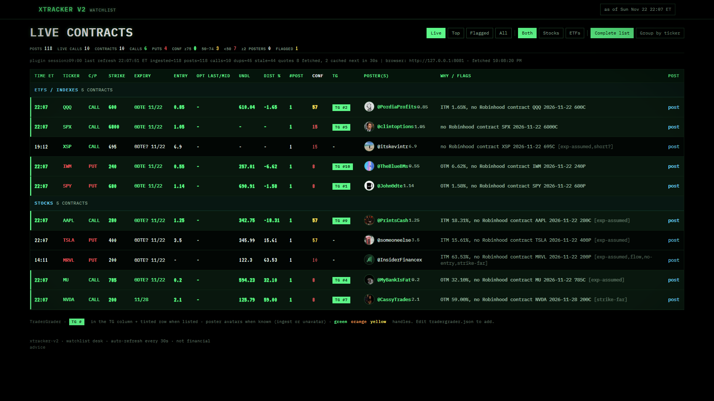

# xtracker-v2

Local options-signal tracker fed by a Chrome extension that scrapes X (Twitter).

Posts flow **extension → localhost ingest → parser → Robinhood/Yahoo quotes → watchlist UI**.

Research / education only. **Not financial advice. Never places trades.**

## Watchlist UI

Local desk at **http://127.0.0.1:8081**:



### Buttons (chips)

| Button | What it does |
|---|---|
| **Live** | Live option contracts only (parsed call/put + strike). Default view. |
| **Top** | Same table, but only rows where a poster is on the TraderGrader **green** list. Sorts by TG rank (best first). |
| **Flagged** | Posts that are **not** live calls: no real strike, two outcomes / conditional, or a trade idea that was never entered. Not scored. |
| **All** | Live contracts and flagged notes together. |
| **Both** | Show ETFs/indexes and stocks in one table (two sections when Both is on). |
| **Stocks** | Only single-name tickers (MU, NVDA, AAPL, …). |
| **ETFs** | Only ETF / index underlyings: SPY, QQQ, IWM, SPX, SPXW, XSP, NDX, RUT, VIX, DIA, TQQQ, SQQQ, UVXY, VXX. |
| **Complete list** | Flat sorted rows (no ticker grouping). |
| **Group by ticker** | Group header per ticker, contracts under it. |

Click a column header (Time, Ticker, Strike, Conf, TG, …) to sort. Click again to flip ascending / descending.

### Table columns

| Column | Meaning | How it is calculated |
|---|---|---|
| **Time ET** | Latest post time on this contract (America/New_York). | Max `posted_at` among all posts merged into the row. |
| **Ticker** | Underlying symbol. | Parsed from the post (`SPXW` normalized to `SPX`). |
| **C/P** | Call or put. | Parsed side (`C` / `P`). |
| **Strike** | Option strike. | Parsed strike number. |
| **Expiry** | Expiration label. | Explicit date in the post, else assumed (e.g. 0DTE / weekly) with an `exp-assumed` flag when guessed. |
| **Entry** | Premium from the **first** post on this contract that had an entry. | Parsed `$` / `@` / `at` style fill; later posters show their own entry next to their handle in **Poster(s)**. |
| **Opt last/mid** | Live option mark + peak arrow. | Robinhood (or Yahoo) **last** / **mid** (mid = `(bid + ask) / 2`). Green **▲** when the mark is at today’s tracked peak; red **▼** when it has fallen below that peak. |
| **Peak** | High-water option mark while tracking this contract today. | Max mid/last seen since the row started (restored from today’s scores CSV on restart). Shows `%` vs Entry when entry exists. |
| **Undl** | Underlying last price. | Equity/index quote (Robinhood for stocks; Yahoo for index symbols like SPX/XSP). |
| **Dist %** | How far the strike is from the underlying. | `(strike − undl) / undl × 100`. Positive = strike above spot; negative = below. Used with side for ITM/OTM in **Why**. |
| **#Post** | How many distinct posters agree on this contract. | Count of unique handles on the same ticker / strike / C\|P / expiry. |
| **Conf** | Confidence 0–100 (not a predicted return). | Weighted score from market context + quote quality + consensus (see below). Color: ≥75 high, 50–74 mid, &lt;50 low. |
| **TG** | TraderGrader badge. | Best (lowest) rank among posters from `tradergrader.json`. Green / orange / yellow tint the row and handle. |
| **Poster(s)** | Who posted it. | Unique handles; each can show avatar, their latest entry, and a link to their post. |
| **Why / flags** | Short reasons behind Conf, plus parser tags. | Built during scoring (ITM/OTM, trend, mark vs entry, …) plus flags like `exp-assumed`, `no-entry`, `strike-far`, `flow`. |
| **Post** | Link out. | URL of the latest post on the row (or first if only one). |

One row = one contract. Multiple posts from the same or different people on that contract are merged; they are not duplicated as separate rows.

### Confidence score (Conf)

`Conf` is a 0–100 research score. Parts with no data are dropped and the rest is rescaled.

| Part | Max weight | Idea |
|---|---:|---|
| Moneyness | 20 | Closer ITM / near ATM scores higher (tighter band for 0DTE). |
| Trend | 20 | Spot vs VWAP and vs open, in the direction of the call/put. |
| Reach | 10 | Strike vs day high (calls) or day low (puts). |
| Relative volume | 10 | Intraday volume vs recent average (when available). |
| Option quality | 20 | Bid/ask spread, liquidity (volume + OI), mark vs entry, high IV penalty. |
| Consensus | 10 | More distinct posters on the same contract → higher. |
| Poster credibility | 10 | From X profile age / followers when that metadata is present. |

Robinhood quote-only underlyings often lack VWAP/open/high/low, so trend / reach / RVOL may be skipped and Conf is rescaled from what remains.

### KPI strip

The numbers under the title (Posts, Live calls, Contracts, Calls/Puts, Conf bands, ≥2 posters, Flagged) are counts from the current day’s scored table and flagged list.

## What it does

- Scrapes `x.com/home` or `x.com/notifications` from whoever is logged into Chrome (no X API token required in plugin mode)
- Parses option calls vs flagged notes (trade ideas, conditionals, no real strike)
- Scores contracts with live quotes (Robinhood MCP or Yahoo)
- Serves a watchlist at **http://127.0.0.1:8081**
- Reloads today’s CSV on restart so a refresh is not a blank “fresh sync”
- Highlights TraderGrader handles from `tradergrader.json` (green / orange / yellow)
- Splits the table into **Stocks** vs **ETFs** (SPY, QQQ, IWM, SPX, XSP, …)

This repo is the **v2** app (port **8081**). The older X-API tracker on port **8080** is a separate tree and is not required.

## Requirements

- Windows / macOS / Linux with Python 3.11+
- Chrome (for the scrape extension)
- Optional: Robinhood Trading MCP token for live option quotes

## Setup

```powershell
cd xtracker-v2
py -m venv .venv
.\.venv\Scripts\Activate.ps1
pip install -r requirements.txt
```

```bash
cd xtracker-v2
python3 -m venv .venv
source .venv/bin/activate
pip install -r requirements.txt
```

### Robinhood quotes (optional)

Token files are **not** in git. Use the redacted examples, then put real values locally:

```powershell
copy robinhood_token.json.example robinhood_token.json
copy robinhood_client.json.example robinhood_client.json
# replace XXXXXXX with your tokens, or restore from .local-secrets\ (gitignored backup)
```

Or log in once:

```powershell
python robinhood_mcp.py
```

Without Robinhood, start with `--quotes yahoo` (delayed).

**Do not commit** `robinhood_token.json`, `robinhood_client.json`, `x_token.json`, or `.local-secrets/`.

## Chrome extension

1. Chrome → `chrome://extensions` → Developer mode → **Load unpacked**
2. Select the `extension/` folder in this repo
3. Keep an **x.com/home** or **x.com/notifications** tab open (logged in)
4. Open the extension viewer → **Start**
5. Leave **Push to xtracker-v2** on (default `http://127.0.0.1:8081/api/ingest`)

The extension follows the X account signed into that Chrome profile. Switch login, and the feed changes with it.

## Run

```powershell
python xtracker.py --plugin --now
```

| | |
|---|---|
| Watchlist | http://127.0.0.1:8081 |
| Ingest | `POST http://127.0.0.1:8081/api/ingest` |
| Default refresh | 30s |

`--now` keeps researching outside the weekday 09:00–16:00 ET window. Without `--now`, ingest still accepts; the research loop follows that window.

Useful flags:

| Flag | Meaning |
|---|---|
| `--plugin` | Extension ingest only (default path for v2) |
| `--now` | Ignore market hours |
| `--port 8081` | UI + ingest port |
| `--interval 30` | Table refresh seconds |
| `--quotes robinhood\|yahoo` | Quote source |
| `--fresh` | Wipe today’s CSV and start empty |
| `--ingest-secret` | Optional shared secret (`XTRACKER_INGEST_SECRET`) |

Do **not** use `--fresh` for a normal start; the default reloads today’s `logs/calls_*.csv` and `flagged_*.csv`.

### Optional X API poll

```powershell
python xtracker.py --with-x-api --plugin --now
```

Needs `x_token.json` (gitignored). Prefer plugin-only.

Edit `tradergrader.json` to change green / orange / yellow handles; the tracker reloads it on the next refresh (no code change).

## Layout

| Path | Role |
|---|---|
| `xtracker.py` | Main app, CSV persistence, research loop |
| `webview.py` | Local UI + `/api/ingest` (127.0.0.1 only) |
| `parser.py` | Live vs flagged parsing |
| `research.py` | Quotes + confidence score |
| `robinhood_mcp.py` | Robinhood MCP quote client |
| `tradergrader.json` | Green / orange / yellow highlight roster |
| `extension/` | MV3 scrape + push to localhost |
| `logs/` | Daily CSV (gitignored) |
| `test_parser.py` | Parser checks: `python test_parser.py` |
| `smoke_ingest.py` | Sample ingest without Chrome |

## Smoke test (no Chrome)

With the tracker running:

```powershell
python smoke_ingest.py
```

Or POST JSON `{ "posts": [ { "id", "handle", "text", "time", "url" } ] }` to `/api/ingest`, then open the watchlist.

## Security notes

- Server binds **127.0.0.1** only
- Real credentials stay on this machine only:
  - Working copies: `robinhood_token.json`, `robinhood_client.json`, `x_token.json` (gitignored)
  - Local backup: `.local-secrets/` (gitignored)
  - Repo templates: `*.json.example` with `XXXXXXX` placeholders
- Optional ingest auth: set the same secret in the env/flag and in the extension viewer
- Before every push, confirm `git status` does **not** list token JSON files

## Disclaimer

Public social posts are not verified fills. Quotes can be delayed or missing. This tool does not place orders and is not financial advice.
